<div align="center">

# TinyML Pet Separation Monitor

**Privacy-preserving, on-device vision that detects restless, separation-related behaviour in pets left alone. It measures each animal against its own calm baseline.**

[](LICENSE)

-4B32C3)


*Capstone project for COM683, BSc (Hons) Computing Systems, Ulster University London.*

</div>

---

## Table of contents

- [Overview](#overview)
- [Key features](#key-features)
- [System architecture](#system-architecture)
- [How detection works](#how-detection-works)
- [Results](#results)
- [Repository layout](#repository-layout)
- [Getting started](#getting-started)
- [Configuration reference](#configuration-reference)
- [Command-line reference](#command-line-reference)
- [Backend API](#backend-api)
- [Dataset](#dataset)
- [Privacy and security](#privacy-and-security)
- [Limitations and roadmap](#limitations-and-roadmap)
- [Known issues](#known-issues)
- [Documentation](#documentation)
- [Licence and acknowledgements](#licence-and-acknowledgements)

---

## Overview

Separation-related behaviour such as pacing, restlessness and constant repositioning is hard for owners to see, because it happens when nobody is home. Cloud cameras can capture it, but they stream video of the inside of a home to a third party.

This project takes a different approach:

1. A **microcontroller with a camera** runs a tiny object-detection model entirely on-device. It sends only the **centroid** of the detected pet (two numbers and a confidence), never an image.
2. A **Python gateway** turns that stream of positions into **behavioural features** such as zone transitions, spatial spread and speed. It scores each window against a **baseline calibrated on the same animal while calm**.
3. A sustained deviation is confirmed as an **episode** and delivered to a **Laravel backend**, which stores it and shows it on a mobile-friendly dashboard.

Because the decision is *"is this animal behaving unusually for itself?"* and not a fixed population rule, the system adapts to calm-but-active and sleepy-but-anxious animals alike. This assumes a representative calibration.

## Key features

| Area | Highlights |
|---|---|
| **Edge AI** | Edge Impulse **FOMO** detector, 96×96 input, single class `pet`, int8-quantised, about 181 KB TFLite Micro arena on an nRF52840 (256 KB RAM). |
| **Privacy by design** | No pixels leave the board. The serial protocol carries only `D,cx,cy,conf,millis` or `N,-1,-1,0,millis`. |
| **Per-animal baselining** | Calibration on 16 min of calm behaviour, with non-overlapping windows and **sigma floors** that stop z-scores exploding when a calm pet never moves. |
| **Robust decisions** | Four features → clipped z-scores (±6) → composite → threshold → **3-window debounce**. |
| **Reliable delivery** | Retries with backoff, a local **offline queue**, and a drainer. Replay is safe because the API is **idempotent on `event_id`**. |
| **Reproducible evaluation** | `ablations.py` replays recorded sessions under 23 configurations. A re-run reproduces `data/ablation_results.csv` exactly. |
| **Hardware-free development** | Every gateway mode (replay, calibration, stats, evaluation) works from recorded CSV files. |

---

## System architecture

```mermaid
flowchart LR
    subgraph EDGE["Edge — Arduino Nano 33 BLE Sense"]
        CAM["OV7675 camera<br/>QQVGA RGB565"] --> PRE["Resize / crop<br/>to 96×96"]
        PRE --> FOMO["FOMO detector<br/>(TFLite Micro, int8)"]
        FOMO --> SEL["Best box ≥ 0.50<br/>→ centroid"]
    end

    subgraph GW["Gateway — gateway.py"]
        PARSE["Parse CSV line"] --> ZONE["2×2 zone<br/>assignment"]
        ZONE --> WIN["120 s sliding window<br/>(re-evaluated every 10 s)"]
        WIN --> FEAT["4 behavioural<br/>features"]
        FEAT --> Z["z-scores vs<br/>baseline.json"]
        Z --> DEC["Composite ≥ 2.0<br/>for 3 windows"]
    end

    subgraph BE["Backend — Laravel 13 + SQLite"]
        API["POST /api/episodes<br/>validate + upsert"] --> DB[("episodes")]
        DB --> DASH["Dashboard /"]
        DB --> EXP["CSV /export"]
    end

    SEL -- "USB serial 115200<br/>D,cx,cy,conf,millis" --> PARSE
    DEC -- "HTTP JSON" --> API
    DEC -. "POST failed" .-> Q["episodes_pending.jsonl"]
    Q -. "drain_queue.py<br/>(idempotent replay)" .-> API
```



Each tier has a single responsibility, and they talk over **plain-text interfaces you can inspect**: a CSV serial line and a JSON payload. Each tier can therefore be tested, replaced or replayed on its own.

### Edge tier (`firmware/`)

| Item | Detail |
|---|---|
| MCU | nRF52840 (Cortex-M4F, 64 MHz, 256 KB RAM, 1 MB flash) |
| Camera | OV7675, started at QQVGA / RGB565 / 1 FPS. The sketch overrides `readFrame()` to read the full VGA sensor in strips and interpolate down, keeping the correct aspect ratio within the Nano's memory. |
| Model | Edge Impulse project `1061466`, FOMO, 96×96, 1 class, quantised. The largest arena is 185,036 bytes. |
| Post-processing | Of the boxes with confidence ≥ `CONF_THRESHOLD` (0.50), keep the single most confident one and output its centre. |
| Output | **Exactly one line per frame**, including on capture or inference failure, so the gateway always has a continuous timeline. |
| Measured rate | **0.32 FPS** (about 3.1 s/frame) across all recorded sessions. The model itself takes about 29 ms for DSP and about 820 ms for classification. |

**Serial protocol**

| Line | Meaning |
|---|---|
| `D,<cx>,<cy>,<conf>,<millis>` | Pet detected; centroid in 96×96 pixel coordinates |
| `N,-1,-1,0,<millis>` | No detection, or capture/inference error |
| `# dsp=… cls=… loop=…` | Optional timing diagnostics (`DEBUG_TIMING 1`); ignored by the gateway |

### Gateway tier (`gateway/`)

| File | Role |
|---|---|
| `gateway.py` | Live/replay pipeline, calibration, stream statistics, live "radar" visualiser, webhook delivery |
| `drain_queue.py` | Replays the offline queue. Moves delivered episodes to `episodes_sent.jsonl`, quarantines HTTP 422 to `episodes_bad.jsonl`, keeps everything else queued |
| `ablations.py` | Evaluation harness: replays labelled sessions under each configuration and writes `ablation_results.csv` |
| `baseline.json` | The committed calm baseline (μ, floored σ, raw σ, number of windows) |

### Backend tier (`backend/`)

The backend is Laravel 13 with SQLite. It validates and stores episodes, and serves a dark-themed, mobile-first dashboard that **auto-refreshes every 5 s**. The dashboard shows the latest composite score with a gauge, the total episode count, the time since the last detection, and the 25 most recent episodes with per-feature values and a severity badge.

---

## How detection works

### 1. Features (per 120 s window, detected samples only)

The 96×96 frame is split into a **2×2 grid** (zones Z0–Z3). Windows with fewer than `MIN_DETECTIONS` (5) detections are skipped and counted as *sparse*.

| Feature | Definition | Unit | Captures |
|---|---|---|---|
| `transition_rate` | zone changes ÷ window span | transitions/min | how often the pet moves between areas |
| `dwell_entropy` | Shannon entropy of zone occupancy, −Σ pᵢ log₂ pᵢ | bits (0–2) | how evenly time is spread across zones |
| `position_var` | mean squared distance of centroids from their mean | px² | how widely the pet ranges in the frame |
| `activity` | mean centroid speed between consecutive detections | px/s | how fast it moves |

### 2. Baseline and sigma floors

Calibration collects **non-overlapping** 120 s windows of calm behaviour for 960 s. It refuses to save a baseline with fewer than 8 windows. A calm pet may never change zone, which gives a true σ of 0 and would make the z-score infinite. Each σ is therefore floored:

```
σ = max(raw_σ, 0.15 × |μ|, ABS_FLOOR[feature])
```

The committed `baseline.json` (8 windows) shows why this matters. The subject never changed zone during calibration, so `transition_rate` and `dwell_entropy` had a raw σ of 0 and were floored to 0.5 and 0.1:

| Feature | μ | σ (used) | raw σ |
|---|---:|---:|---:|
| `transition_rate` | 0.000 | 0.500 *(floored)* | 0.000 |
| `dwell_entropy` | 0.000 | 0.100 *(floored)* | 0.000 |
| `position_var` | 34.490 | 35.441 | 35.441 |
| `activity` | 1.224 | 1.193 | 1.193 |

### 3. Scoring and decision

```
z_k        = clip((x_k − μ_k) / σ_k, −6, +6)
composite  = Σ w_k·z_k / |{k : w_k > 0}|     (COMPOSITE_MODE="mean", default)
           = max_k w_k·z_k                    (COMPOSITE_MODE="max")
elevated   = ALONE_CONTEXT and composite ≥ Z_THRESHOLD (2.0)
episode    ⇐ DEBOUNCE_WINDOWS (3) consecutive elevated windows; the streak then resets
```

### 4. Delivery

On an episode, the gateway POSTs JSON to the backend and tries up to 3 times with linear backoff (1.5 s, 3 s, 4.5 s). If every attempt fails, the episode is appended to `episodes_pending.jsonl` for `drain_queue.py`. Every episode carries a UUID `event_id`, and the API upserts on it. If a POST times out *after* the server committed it, the replay updates that row instead of creating a duplicate.

---

## Results

The evaluation replays **9 held-out sessions** (5 calm, 4 restless) against the committed baseline under **23 configurations** in 5 experiments, giving 207 result rows. Running `python gateway/ablations.py` reproduces [`data/ablation_results.csv`](data/ablation_results.csv) exactly.

| Experiment | Configs | Restless sessions flagged | False episodes (calm) | Mean time-to-flag |
|---|---:|:---:|:---:|---|
| Threshold sweep `z ≥ 1.0 … 4.0` | 7 | 4/4 in every config | 0 | 3 windows |
| Debounce `1, 2, 3, 5` | 4 | 4/4 | 0 | 1 → 5 windows (equals the debounce) |
| Composite `mean` vs `max` | 2 | 4/4 | 0 | 3 windows |
| Feature knockout (all, −1 each, activity-only) | 6 | 4/4 | 0 | 3 windows; **11.25** with `activity_only` |
| Window length `60 / 90 / 120 / 180 s` | 4 | 4/4 | 0 | 3 windows |

**Per-session results at the default configuration** (`z ≥ 2.0`, debounce 3, mean composite, 120 s window):

| Session | Label | Windows scored | Episodes | Mean composite | Max composite | First episode (window) |
|---|---|---:|---:|---:|---:|---:|
| `calm_test_01` | calm | 28 | 0 | −0.36 | −0.33 | — |
| `calm_test_02` | calm | 25 | 0 | −0.20 | −0.10 | — |
| `calm_test_03` | calm | 119 | 0 | −0.23 | 0.31 | — |
| `calm_test_04` | calm | 17 | 0 | −0.39 | −0.22 | — |
| `calm_test_05` | calm | 25 | 0 | −0.26 | −0.18 | — |
| `restless_02` | restless | 26 | 8 | 4.96 | 5.44 | 3 |
| `restless_03` | restless | 28 | 9 | 4.99 | 5.15 | 3 |
| `restless_04` | restless | 24 | 8 | 5.07 | 5.20 | 3 |
| `restless_05` | restless | 23 | 7 | 4.99 | 5.11 | 3 |

Windows are evaluated every 10 s, so a time-to-flag of 3 windows is about **30 s** of evaluations.

### Interpretation and caveats

- **The classes separate with a wide margin.** Calm sessions never exceed 0.31, and restless sessions average about 5.0. Every threshold from 1.0 to 4.0 therefore classifies every session correctly. The sweep shows a **ceiling effect**. It doesn't identify an optimal threshold.
- **Removing any one feature changes nothing.** `activity` alone still detects every restless session, but 3–4× more slowly (11.25 windows against 3). The spatial features mainly buy **speed of detection**.
- **This is a proof of pipeline, not a field accuracy claim.** The data comes from one device, one scene, one baseline and scripted sessions. Real-world sensitivity and false-alarm rates remain to be measured; see the [roadmap](#limitations-and-roadmap).

---

## Repository layout

```
.
├── firmware/nano_ble33_sense_camera/   Arduino sketch: capture → FOMO → one CSV line per frame
├── edge-impulse-lib/                   Exported Edge Impulse Arduino library (model + SDK)
├── gateway/
│   ├── gateway.py                      Live/replay pipeline, calibration, stats, radar, webhook
│   ├── drain_queue.py                  Idempotent offline-queue replay
│   ├── ablations.py                    Evaluation sweep (5 experiments, 23 configs)
│   ├── baseline.json                   Committed calm baseline (8 windows)
│   └── requirements.txt
├── backend/                            Laravel 13 API + dashboard (vendor/ and .env not committed)
│   ├── app/Http/Controllers/EpisodeController.php
│   ├── app/Models/Episode.php
│   ├── database/migrations/…_create_episodes_table.php
│   ├── resources/views/dashboard.blade.php
│   ├── routes/{api,web}.php
│   └── tests/Feature/EpisodeApiTest.php
├── data/
│   ├── sessions/                       15 raw serial recordings (calm, restless, probe)
│   ├── ablation_results.csv            Evaluation output (207 rows)
│   └── episodes_sample.jsonl           13 real delivered episode payloads
├── docs/                               Architecture, calibration, board setup, deployment
├── LICENSE                             MIT (original code)
└── NOTICE                              Third-party licences (Edge Impulse SDK, TFLite Micro, CMSIS, …)
```

---

## Getting started

### Prerequisites

| Component | Requirement |
|---|---|
| Gateway | Python 3 with `requests`, `pyserial`, `numpy`, `opencv-python` (see `gateway/requirements.txt`) |
| Backend | PHP **8.4.1+** with `pdo_sqlite`, and Composer. See [Known issues](#known-issues) about the PHP version. |
| Firmware (optional) | Arduino IDE 2.x or `arduino-cli`, the `arduino:mbed_nano` core, and the `Arduino_OV767X` library |
| Hardware (optional) | Arduino Nano 33 BLE Sense (Rev1/Rev2), an OV7675 camera (e.g. from the Tiny Machine Learning Kit), a data-capable USB cable |

### 1. Replay a recorded session (no hardware needed)

```bash
cd gateway
python -m venv .venv && source .venv/bin/activate     # Windows: .venv\Scripts\activate
pip install -r requirements.txt

python gateway.py --show-baseline                      # inspect the committed baseline
python gateway.py --stats  ../data/sessions/restless_03.csv
python gateway.py --replay ../data/sessions/restless_03.csv   # opens the radar window; webhook suppressed
python ablations.py                                    # full evaluation → ablation_results.csv
```

> Run the gateway scripts from **inside `gateway/`**. `baseline.json` and the queue files are resolved relative to the working directory.

### 2. Run the backend

```bash
cd backend
composer install
cp .env.example .env
php artisan key:generate
touch database/database.sqlite          # PowerShell: New-Item database/database.sqlite
php artisan migrate
php artisan serve                       # http://127.0.0.1:8000
```

Smoke-test the idempotent API with a real sample payload:

```bash
head -1 ../data/episodes_sample.jsonl > /tmp/ep.json
curl -s -X POST http://127.0.0.1:8000/api/episodes \
     -H "Content-Type: application/json" -H "Accept: application/json" -d @/tmp/ep.json
# → 201 {"status":"created",...}   Send it again → 200 {"status":"updated",...}
```

### 3. Run live with hardware

1. **Flash the board.** Install the Edge Impulse library from `edge-impulse-lib/`, then upload the sketch. Full steps are in [docs/BOARD_SETUP.md](docs/BOARD_SETUP.md).

   ```bash
   arduino-cli compile --fqbn arduino:mbed_nano:nano33ble firmware/nano_ble33_sense_camera
   arduino-cli upload  --fqbn arduino:mbed_nano:nano33ble -p COM10 firmware/nano_ble33_sense_camera
   ```

2. **Check the stream.** Record a short probe and confirm a detection ratio of **≥ 70 %** and **≥ 15 detections per window**:

   ```bash
   python gateway.py --record ../data/sessions/probe.csv     # Ctrl+C to stop
   python gateway.py --stats  ../data/sessions/probe.csv
   ```

3. **Calibrate** on 16 minutes of genuinely calm behaviour, with the same camera position and lighting as monitoring. See [docs/calibration_protocol.md](docs/calibration_protocol.md).

   ```bash
   python gateway.py --calibrate --record ../data/sessions/calm_baseline.csv
   ```

4. **Monitor.**

   ```bash
   PET_SERIAL_PORT=/dev/ttyACM0 python gateway.py            # Windows: set PET_SERIAL_PORT=COM10
   ```

> The sketch waits in `while (!Serial);` until a serial host connects. Remove that line if the board has to run without a host.

### 4. Run the backend tests

```bash
cd backend && php artisan test
```

`tests/Feature/EpisodeApiTest.php` covers dashboard rendering, episode creation (201), **idempotent replay** (200 with the row count unchanged), rejection of payloads without `event_id` (422), and the JSON index and CSV export endpoints.

---

## Configuration reference

### Environment variables

| Variable | Default | Used by | Purpose |
|---|---|---|---|
| `PET_SERIAL_PORT` | `COM10` | `gateway.py` | Serial port of the board (e.g. `/dev/ttyACM0`) |
| `PET_WEBHOOK_URL` | `http://127.0.0.1:8000/api/episodes` | `gateway.py`, `drain_queue.py` | Backend ingestion endpoint |
| `PET_DEVICE_ID` | `nano33-01` | `gateway.py` | Device identifier stored with each episode |

### Gateway constants (`gateway/gateway.py`)

| Constant | Default | Meaning |
|---|---|---|
| `WINDOW_SEC` | `120` | Feature window length (s) |
| `STEP_SEC` | `10` | Re-evaluation interval while monitoring (s) |
| `MIN_DETECTIONS` | `5` | Windows with fewer detections are skipped |
| `CALIBRATION_SEC` | `960` | Calibration duration (s) |
| `CALIB_STEP_SEC` | `= WINDOW_SEC` | Non-overlapping calibration windows |
| `MIN_BASELINE_N` | `8` | Minimum windows for a valid baseline |
| `SIGMA_REL_FLOOR` | `0.15` | σ ≥ 15 % of \|μ\| |
| `SIGMA_ABS_FLOOR` | `0.5 / 0.10 / 25 / 1.0` | Absolute σ floor per feature (own units) |
| `Z_CLIP` | `6.0` | Per-feature z-score clip |
| `FEATURE_WEIGHTS` | all `1.0` | Per-feature weight in the composite; `0` disables a feature |
| `COMPOSITE_MODE` | `"mean"` | `"mean"` (all features must deviate) or `"max"` (any one may) |
| `Z_THRESHOLD` | `2.0` | Composite threshold for an elevated window |
| `DEBOUNCE_WINDOWS` | `3` | Consecutive elevated windows needed to fire an episode |
| `ALONE_CONTEXT` | `True` | "Owner away" gate (stub; see roadmap) |
| `WEBHOOK_RETRIES` | `3` | POST attempts before queueing locally |

### Firmware constants (`nano_ble33_sense_camera.ino`)

| Constant | Default | Meaning |
|---|---|---|
| `CONF_THRESHOLD` | `0.50` | Minimum box confidence counted as a detection |
| `LOOP_DELAY_MS` | `0` | Optional delay between frames |
| `DEBUG_TIMING` | `0` | `1` prints `#`-prefixed per-frame timing lines |

---

## Command-line reference

**`gateway.py`**

| Flag | Description |
|---|---|
| *(none)* | Monitor the live serial stream (needs `baseline.json`) |
| `--replay FILE` | Read a recorded session instead of serial. Episodes are logged but **not POSTed** |
| `--record FILE` | Copy the raw serial stream to `FILE` while running |
| `--calibrate` | Build a new baseline. Combine with `--replay` to calibrate offline |
| `--stats FILE` | Report the real frame rate, detection ratio and duration, and recommend window/calibration settings |
| `--show-baseline` | Print the current baseline and exit |

**`drain_queue.py`**: `--dry-run` lists queued episodes without sending them.

**`ablations.py`**: `--experiment {threshold,debounce,composite,feature_knockout,window_length}` runs a single experiment.

---

## Backend API

| Method & route | Description | Responses |
|---|---|---|
| `POST /api/episodes` | Validate and `updateOrCreate` by `event_id` | `201` created · `200` updated (replay) · `422` invalid |
| `GET /api/episodes` | The 100 most recent episodes (JSON) | `200` |
| `GET /` | Dashboard | `200` |
| `GET /export` | All episodes as CSV | `200 text/csv` |
| `GET /up` | Health check | `200` |

**Request body** (all fields required unless marked):

```json
{
  "event_id": "f780c490-7f11-4a4a-8f6d-aff2da5dc142",
  "device_id": "nano33-01",
  "timestamp": 1786189508.39,
  "composite_z": 3.05,
  "z_scores":  {"transition_rate": 1.217, "dwell_entropy": 3.707, "position_var": 5.062, "activity": 2.212},
  "features":  {"transition_rate": 8.444, "dwell_entropy": 1.46,  "position_var": 978.178, "activity": 8.075},
  "window_sec": 120
}
```

`event_id` must be a UUID. `device_id` is optional (max 64 characters). `timestamp` is Unix epoch seconds. All four `z_scores.*` and `features.*` keys are required and numeric.

**Response**

```json
{ "status": "created", "id": 1, "event_id": "f780c490-…", "severity": "moderate" }
```

**Storage.** Each z-score and feature is stored in **its own column** (`z_*`, `f_*`) rather than a JSON blob, so evaluation queries and CSV export can read them directly. The full validated payload is also kept in `raw_payload` for audit and reprocessing. `event_id` has a unique index; `device_id` and `occurred_at` are indexed.

**Severity bands** are for display only, not a clinical grade: `low` < 3.0 ≤ `moderate` < 4.0 ≤ `high`.

---

## Dataset

Each line of `data/sessions/*.csv` is a raw serial line (`D,cx,cy,conf,millis` or `N,-1,-1,0,millis`). The figures below come from `gateway.py --stats`:

| File | Role | Duration | Detection ratio |
|---|---|---:|---:|
| `calm_baseline_v2.csv` | Calibration source for `baseline.json` | 16.1 min | 100.0 % |
| `calm_test_01.csv` | Held-out calm | 5.9 min | 97.3 % |
| `calm_test_02.csv` | Held-out calm | 5.5 min | 79.2 % |
| `calm_test_03.csv` | Held-out calm | 25.6 min | 43.9 % |
| `calm_test_04.csv` | Held-out calm | 3.8 min | 74.3 % |
| `calm_test_05.csv` | Held-out calm | 5.5 min | 54.7 % |
| `restless_02.csv` | Held-out restless | 5.5 min | 81.0 % |
| `restless_03.csv` | Held-out restless | 6.3 min | 80.8 % |
| `restless_04.csv` | Held-out restless | 5.1 min | 92.9 % |
| `restless_05.csv` | Held-out restless | 5.2 min | 87.0 % |
| `restless_01.csv` | Early 2-minute restless recording (not evaluated) | 2.3 min | 77.3 % |
| `probe.csv`, `probe2.csv`, `probe3.csv` | Stream-quality checks used to choose the window length | 2–3 min | 11.9 / 87.8 / 100 % |
| `calm_01.csv` | Earliest recording. It contains stock Edge Impulse text output, which the parser skips | 11.6 min | 9.5 % |

`data/episodes_sample.jsonl` holds 13 real delivered payloads from development. Some were recorded while `WINDOW_SEC` was still 60.

---

## Privacy and security

**Privacy.** No camera image is transmitted or stored at any tier. Only centroids, confidences and derived statistics leave the device.

**Security.** This is a **research prototype** meant for localhost or a trusted LAN. Before you expose it more widely:

| Issue | Current state | Recommended fix |
|---|---|---|
| Ingestion is unauthenticated | Anyone who can reach the port can insert episodes | Issue the gateway a Sanctum token (Sanctum is installed) and protect the route with `auth:sanctum` |
| Dashboard and `/export` are public | They expose behavioural history | Put them behind authentication or an access-controlled reverse proxy |
| Plain HTTP | Payloads travel in clear text | Terminate TLS at a reverse proxy (Caddy or nginx) |
| `APP_DEBUG=true` in `.env.example` | Stack traces are shown on errors | Set `APP_ENV=production` and `APP_DEBUG=false` |
| `APP_KEY` | Not committed | Generate one per deployment; rotate it if it's ever exposed |

See [docs/deployment_notes.md](docs/deployment_notes.md) for details.

---

## Limitations and roadmap

- [ ] **Context gate.** Replace the `ALONE_CONTEXT = True` stub with a real "owner away" signal (geofence, door sensor, calendar).
- [ ] **Field data.** Longer, unscripted recordings of real pets in several homes and lighting conditions, to measure real sensitivity and false-alarm rates.
- [ ] **Multi-device support.** One baseline per `device_id`, with the baseline selected on the gateway and stored by the backend.
- [ ] **Throughput.** Only about 0.85 s of each 3.1 s frame is inference. Profile the camera's 1 FPS setting and the strip-wise capture/resize path (`DEBUG_TIMING 1`).
- [ ] **Hardening.** Sanctum token auth, TLS, and authentication for the dashboard and export.
- [ ] **Baseline drift.** Automatic recalibration prompts when the sparse-window rate exceeds 20 % or the scene changes.

---

## Known issues

These came out of a full review of the repository and a reproduction of the results:

1. **PHP version mismatch.** `composer.json` declares `php: ^8.3`, but the committed `composer.lock` resolves Symfony 8.1 components that need **PHP ≥ 8.4.1**. On PHP 8.3, `composer install` fails with "lock file does not contain a compatible set of packages". Use PHP 8.4+, or raise the constraint in `composer.json` to `^8.4` so the two agree.
2. **Dashboard thresholds.** The status banner uses 1.5 / 3.0 for *Elevated* / *Alert*. The model's severity badges use 3.0 / 4.0 for *moderate* / *high*. The two scales should be unified.
3. **Detection continuity in some calm test sessions.** `calm_test_03` (43.9 %) and `calm_test_05` (54.7 %) fall below the 70 % detection ratio recommended in the calibration protocol. Results on those sessions are based on fewer windows.
4. **Stale comments.** `ablations.py` says "10 recorded sessions" and lists `restless_06.csv`, which was never recorded and is skipped. A comment in `gateway.py` mentions about 70 samples at 1.18 FPS; the measured rate is 0.32 FPS (about 38 samples per window).
5. **The radar needs a display.** `render_radar()` opens an OpenCV window in live and replay mode. On headless machines, comment out the call in `run()`.
6. **CSV export columns.** `/export` leaves out `event_id`, `device_id` and `window_sec`. Add them if you analyse data from more than one device.

---

## Documentation

| Document | Contents |
|---|---|
| [docs/architecture.md](docs/architecture.md) | Three-tier design, serial protocol, feature definitions, payload, offline queue, backend schema |
| [docs/calibration_protocol.md](docs/calibration_protocol.md) | Stream checks, baseline recording, sigma floors, held-out validation, when to recalibrate |
| [docs/BOARD_SETUP.md](docs/BOARD_SETUP.md) | Hardware, toolchain, flashing, verification, troubleshooting, retraining the model |
| [docs/deployment_notes.md](docs/deployment_notes.md) | Backend and gateway setup, environment variables, security checklist |
| [backend/README.md](backend/README.md) | Backend quick reference |

---

## Licence and acknowledgements

- The **original code** (gateway, backend application code, documentation) is released under the [MIT License](LICENSE).
- **`edge-impulse-lib/`** and the **firmware sketch** contain or are derived from the Edge Impulse SDK and its bundled dependencies (TensorFlow Lite Micro, CMSIS and others). They keep their original licences, mainly Apache-2.0; see [NOTICE](NOTICE) and the file headers.
- **`backend/`** is built on the Laravel skeleton (MIT).

Built by **Abbas Uddin** ([@CodeAbbas](https://github.com/CodeAbbas)) as the COM683 capstone project at Ulster University London. The model was trained with [Edge Impulse](https://edgeimpulse.com/).
